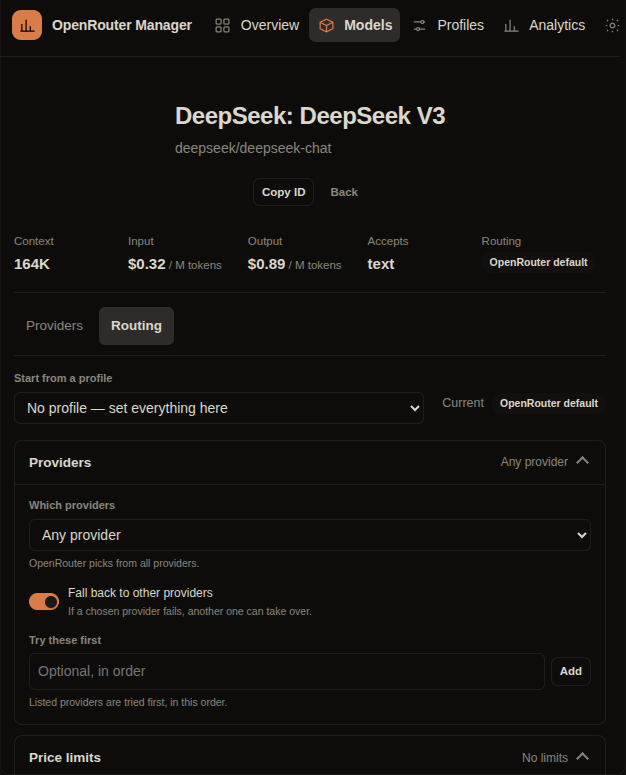
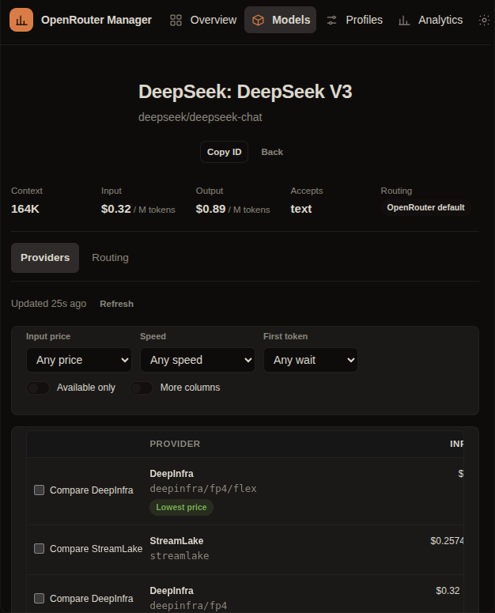

# OpenRouter Manager

**Pick the provider, not just the model.**

OpenRouter Manager is an [OpenChamber](https://openchamber.dev) extension for
controlling how OpenRouter routes each model. Compare providers by price, latency,
and throughput, write a routing policy in a visual editor, and have that policy
injected into real model requests. The selected model never changes.

[](https://docs.openchamber.dev/extensions/)
[](#requirements)
[](https://github.com/AlirezaGhadyani/openrouter-manager/actions/workflows/ci.yml)
[](LICENSE)



*The routing editor for one model. The live JSON preview shows the exact object that will be sent.*

## The problem it solves

OpenRouter chooses a provider for every request. Its defaults are reasonable, but
they do not know that you want the cheapest endpoint, a latency ceiling, a specific
quantization, zero data retention, or no fallbacks at 3 a.m. OpenRouter exposes a
documented `provider` object for exactly this, but OpenChamber and OpenCode give you
no screen for it. Hand-editing requests or maintaining a second router config is
fragile and easy to forget.

OpenRouter Manager makes routing visible and durable:

- **One place** to compare what each provider actually costs and how fast it is.
- **A policy editor** that emits only documented OpenRouter fields.
- **One config file** as the source of truth.
- **A bundled OpenCode plugin** that adds the policy to the outgoing request at the
  last moment, with failure containment: if anything is wrong, the original request
  goes through untouched.

## Features

### Models

- The full OpenRouter catalog from `GET /api/v1/models`, searchable and filterable.
- Per-model context, modalities, published input/output/cache-read prices, loaded
  provider count, and routing state.
- Sort by price, context, provider count, latency P50, or throughput P50.
- Provider-dependent values load on demand and cache for 10 minutes.
- No invented data: a missing value is **N/A**.

### Provider comparison

- Every endpoint for a model from `GET /api/v1/models/{author}/{slug}/endpoints`.
- Independent columns for input, output, cache-read, cache-write, image, and request
  prices.
- Latency P50/P90 in ms (time to first token) and throughput P50/P90 in tokens/sec.
- Context, max output, quantization, status, uptime, and last sync time.
- Cheapest input/output, fastest, lowest-latency, and best cache-read highlights.
- Filter by price, latency, throughput, or availability.
- Compare up to four providers side by side with percentage deltas.
- Exclude a provider directly from its row.



*One model, every provider. Prices, latency, and throughput are shown as published, with N/A when absent.*

Latency and throughput are OpenRouter's rolling **30-minute percentiles**. The API
returns them only to authenticated calls; the panel always calls through
OpenChamber's integration proxy, so a connected key is what makes them appear.

### Routing

- Visual policy editor: provider selection (`only` / `ignore` / `order` /
  `allow_fallbacks`), hard price ceilings (`max_price`), sort strategy,
  `preferred_max_latency`, `preferred_min_throughput`, quantizations, data
  collection, ZDR, required parameters, and distillable-text enforcement.
- Live JSON preview of the exact `{ provider: ... }` object.
- Validation before saving, copy JSON, save, discard, reset to a profile, or remove
  routing.
- Per-model policies and reusable profiles with model overrides.
- Cache-read preference is stored as a **local** preference and clearly labelled:
  OpenRouter has no cache-read ceiling in routing requests, so it is never sent.

### Profiles

- Built-in presets: **Cheapest**, **Fastest**, **Low latency**, **Balanced**,
  **Custom**.
- Create, edit, duplicate, and delete profiles.
- Assign one profile to many models in one action.
- Models with custom overrides are **skipped** unless you tick “Replace custom
  overrides”. Deleting a profile reassigns its models and preserves their overrides.

### Analytics

- Provider leaderboard over loaded endpoint data: coverage, medians, best cache
  price, cheapest/fastest wins, uptime.
- Model leaders: cheapest input/output, fastest, lowest latency, best cache read,
  price spread.
- Local snapshot chart on catalog refreshes, explicitly labelled **local**;
  OpenRouter provides no historical series here.
- Coverage is honest: only models whose endpoint data has been fetched are counted.

### Settings

- API connection state and a real key test (`GET /api/v1/key`).
- Catalog and endpoint cache status, TTLs, manual refresh, and progressive “load 30
  more models”.
- Configuration sync: file path, revision, fingerprint, runtime report, conflict
  detection, reload, copy, and reset with backup.
- Master switch to stop injection without deleting policies.
- Supported and unsupported routing fields, in plain language.

## How it works

```
OpenChamber panel (sandboxed)
  ├─ host.request ─────► OpenChamber integration proxy ─────► https://openrouter.ai/api/v1
  └─ host.readFile / writeFile ─────► ~/.config/openrouter-manager/
                                        ├─ routing.json         source of truth
                                        ├─ runtime-status.json  plugin diagnostics
                                        └─ cache/               catalog + endpoints

OpenCode (managed runtime)
  └─ plugin/index.js
       ├─ reads routing.json (mtime-cached, 100 ms debounce)
       ├─ resolves the model policy by exact id or learned alias
       ├─ rewrites the outgoing JSON body before dispatch
       └─ writes runtime-status.json (throttled)
```

There is no service, daemon, socket, or second store. The panel and the plugin share
one file.

The plugin uses OpenCode's `http.request` hook because it runs at the last point
before dispatch and sees the exact body OpenRouter receives. On each request it:

1. Ignores non-`POST`, non-JSON, non-`openrouter.ai` requests.
2. Reads `body.model` — the model actually served.
3. Resolves a policy by exact id, a documented routing suffix (`:nitro`, `:floor`),
   or a learned alias.
4. Builds only documented `provider` fields.
5. Merges them into an existing `body.provider`; explicit keys win and every other
   body field survives.
6. Replaces the request with a new `Request` built from the original, so method,
   headers, abort signal, redirect, and credentials survive.
7. Records what it applied in `runtime-status.json`, at most every 2 seconds.

Bodies over 16 MiB are left untouched. If anything fails — missing file, invalid
JSON, unknown model, unexpected shape — the original request passes through
unchanged. Routing must never break a model call.

## Install

### Requirements

- **OpenChamber 2.7.0 or newer**, web or desktop. Extensions do not run in the VS
  Code extension or on mobile.
- An OpenRouter account and API key.
- OpenCode 2.2.6 is the tested managed runtime.

### Install from GitHub

Open the [**OpenRouter Manager install page**](https://alirezaghadyani.github.io/openrouter-manager/) and choose **Open in OpenChamber**. The page hands off to the app with the repository already filled in.

Or manually:

1. Open **Settings → Extensions**.
2. Paste this into the **Add** field:

   ```
   https://github.com/AlirezaGhadyani/openrouter-manager.git
   ```

3. Select **Add**.
4. Approve the three requests:
   - **Read and write files outside the project** — only
     `~/.config/openrouter-manager/*`.
   - **Connect to an external service** — OpenRouter, at
     `https://openrouter.ai`.
   - **Add a plugin to OpenCode** — the bundled routing plugin.

### Connect the key once

1. Open **Settings → Integrations → OpenRouter**.
2. Paste an OpenRouter API key.
3. Return to the extension and open **Settings → Test connection**.

The key stays in OpenChamber. It never enters this extension's page, the plugin,
logs, generated JSON, or error messages. OpenChamber attaches it to API calls.

### Update

Git installs can update themselves. **Settings → Extensions** checks at most once
an hour; choose **Check for updates** to check now. The update keeps permissions,
profiles, and policies.

### Install from a folder (development)

```sh
git clone https://github.com/AlirezaGhadyani/openrouter-manager.git
cd openrouter-manager
npm ci
npm run build
```

Then paste the absolute folder path into **Settings → Extensions**. A folder install
runs from that folder and does not use the update button.

## Quick start

1. Install, approve the permissions, and connect the OpenRouter key.
2. Open **Models**, search for a model, and open it.
3. Use the **Providers** tab to compare endpoints. Select a provider row to see its
   price, latency, throughput, and status.
4. Open the **Routing** tab. Start from a profile or set providers, price ceilings,
   and speed preferences yourself.
5. Watch the JSON preview, then **Save policy**.
6. Send one request with that model. In **Settings → Configuration sync → Runtime**,
   the last applied request should show the model, routing key, profile, and field
   names actually sent.

Profiles are reusable. Open **Profiles**, pick a preset, and assign it to several
models at once. Models with custom overrides are skipped unless you explicitly
replace them.

## Permissions and privacy

| Permission | Scope | Why |
|---|---|---|
| Filesystem | `~/.config/openrouter-manager/*` | Config, runtime status, and caches |
| Network (integration) | `https://openrouter.ai` | Catalog, endpoints, and key test; the token is attached by OpenChamber |
| OpenCode plugin | `plugin/` in this package | Injects policies into outgoing requests |

The bundled plugin runs inside OpenCode with your full access, like a local service.
It reads only this extension's config and writes only its status file. It rewrites
requests only to `https://openrouter.ai`; the documented `eu.` and `us.` regional
hosts and custom gateways are not intercepted.

## Configuration

One file is the source of truth:

```json
{
  "schemaVersion": 1,
  "revision": 7,
  "updatedAt": "2026-11-08T10:00:00.000Z",
  "settings": { "enabled": true, "defaultProfileId": "balanced", "providerIds": ["openrouter"] },
  "profiles": [
    {
      "id": "cheapest",
      "name": "Cheapest",
      "builtin": true,
      "policy": { "mode": "all", "providers": [], "order": [], "allowFallbacks": true, "sort": "price" }
    }
  ],
  "models": {
    "deepseek/deepseek-v4.1-flash-1017": {
      "profileId": "cheapest",
      "overrides": { "maxPromptPerMillion": 0.5 },
      "customized": true,
      "updatedAt": "2026-11-08T10:00:00.000Z"
    }
  },
  "aliases": { "deepseek/deepseek-v4.1-flash-20261017": "deepseek/deepseek-v4.1-flash-1017" }
}
```

- Writes use OpenChamber's atomic `writeFile` (temp + rename).
- External edits are detected on focus and before every save; a changed file blocks
  the save instead of overwriting it.
- Schema 0 is migrated to 1. A backup is written before the migrated file is saved.
- Unknown fields are dropped; invalid numbers and enums become “not set”.
- A file from a newer schema is opened read-only, and reset is disabled.

Routing is read per request. A saved revision applies to the next request, not the
one already in flight.

### Routing fields

Only documented OpenRouter fields are emitted, and only when set: `order`, `only`,
`ignore`, `allow_fallbacks`, `sort` (with optional `partition`), `max_price`
(prompt/completion/image/request), `preferred_max_latency`,
`preferred_min_throughput`, `quantizations`, `data_collection`, `zdr`,
`require_parameters`, and `enforce_distillable_text`.

Two things are deliberately **not** sent:

- A cache-read price ceiling. OpenRouter has no such field; the value is stored
  locally and used only to flag providers.
- Any guessed, display-name-based, or undocumented field.

See [docs/API-LIMITATIONS.md](docs/API-LIMITATIONS.md) for the full table, endpoint
behavior, matching edge cases, and known gaps.

## Development

```sh
npm ci
npm run typecheck     # tsc --noEmit
npm test              # node --test --experimental-transform-types, 70 tests
npm run build         # esbuild: panel/main.js, plugin/index.js, panel/style.css
npm run check         # typecheck + tests + build + package checks
```

```
src/shared/      pure policy, config, normalization, and injection logic
src/plugin/      OpenCode plugin entry; bundled to plugin/index.js with no imports
src/data/        host bridge, OpenRouter client, cache and config repository
src/panel/       store, DOM layer, routing editor, views
test/            unit and plugin lifecycle tests
scripts/         esbuild build and package validation
panel/           built HTML, JS, CSS
plugin/          built plugin folder (index.js + package.json)
test-harness/    mock OpenChamber host for visual work
docs/            architecture, API limits, testing, troubleshooting
```

Only `package.json`, `icon.svg`, `panel/`, and `plugin/` ship to OpenChamber.
`node_modules` is not shipped or read at runtime. Built files are committed because
OpenChamber never builds at install time.

To ship an update: bump `version` in `package.json` and
`src/shared/version.ts`, run `npm run check`, commit the source and the rebuilt
files, and push.

`test-harness/host.html` is a mock OpenChamber host that answers the host protocol
with a sample catalog and endpoints. Open it in a browser; add `?theme=light` for
light mode. It is not installed as part of the extension.

## Limitations

- **No cache-read price ceiling.** Not supported by OpenRouter routing; stored
  locally and labelled.
- **Cache-write pricing is usually absent.** Displayed as N/A when the API does not
  return it.
- **Performance metrics need a connected key.** Unauthenticated calls receive
  `null`.
- **No OpenRouter history.** Only rolling 30-minute percentiles exist; the snapshot
  chart is local.
- **Routing variants:** `:nitro` and `:floor` still resolve the base model's policy,
  but OpenRouter's variant semantics can override `sort`. The model id is never
  rewritten.
- **Only `https://openrouter.ai` traffic is intercepted.** Custom gateways and the
  documented `eu.`/`us.` regional hosts are not; request bodies over 16 MiB are left
  untouched.
- **Extensions are unavailable in VS Code and on mobile.**

## Troubleshooting

See [docs/TROUBLESHOOTING.md](docs/TROUBLESHOOTING.md) for the extension not
appearing, a disconnected key, a policy that is not applied, configuration
conflicts, N/A prices, rate limits, and recovery.

The two files worth inspecting are `~/.config/openrouter-manager/routing.json` (the
source of truth) and `~/.config/openrouter-manager/runtime-status.json` (what
OpenCode last loaded and applied). Neither contains an API key.

## Contributing

Issues and pull requests are welcome. Read [CONTRIBUTING.md](CONTRIBUTING.md) and
run `npm run check` before opening a pull request. For security reports, use
[SECURITY.md](SECURITY.md).

## Related

- [Prompt Studio](https://github.com/AlirezaGhadyani/prompt-studio) — a searchable prompt library that inserts into the OpenChamber composer.

## License

MIT © Alireza Ghadyani

